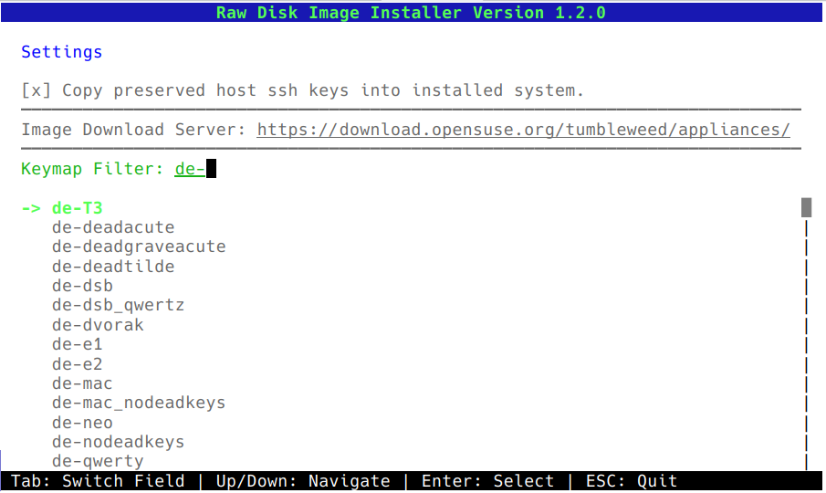
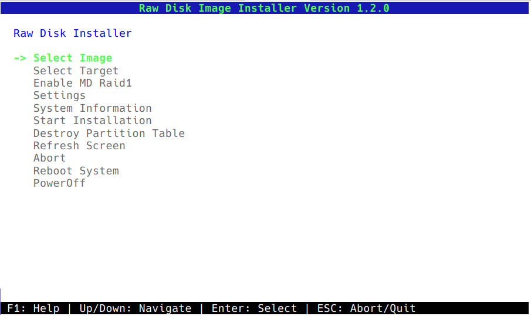
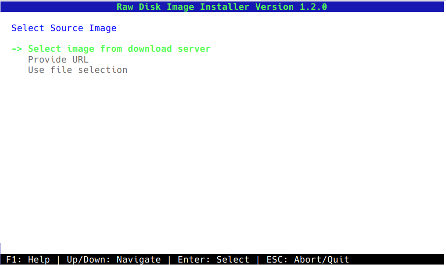
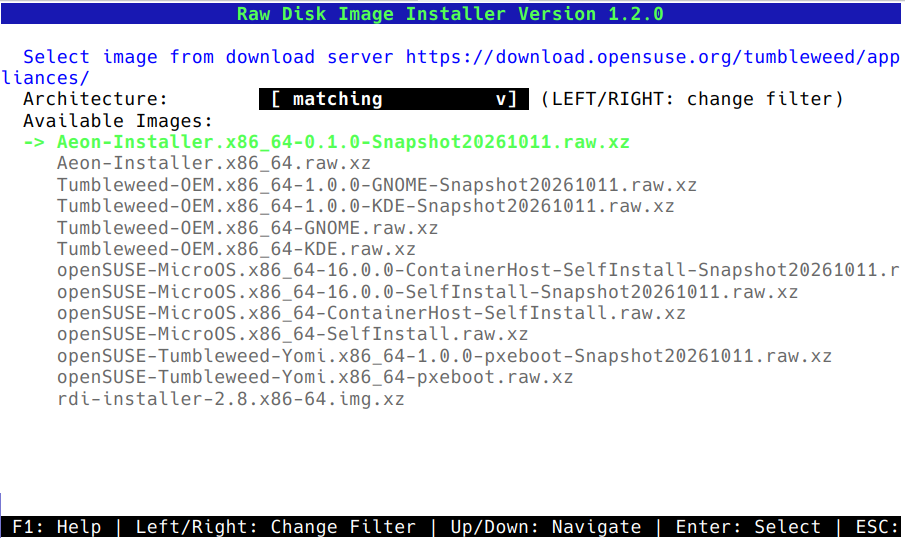
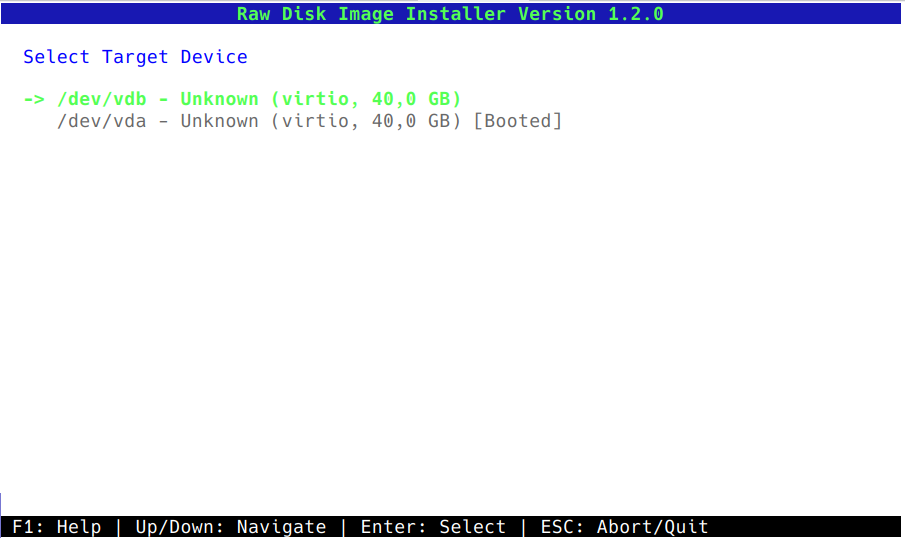
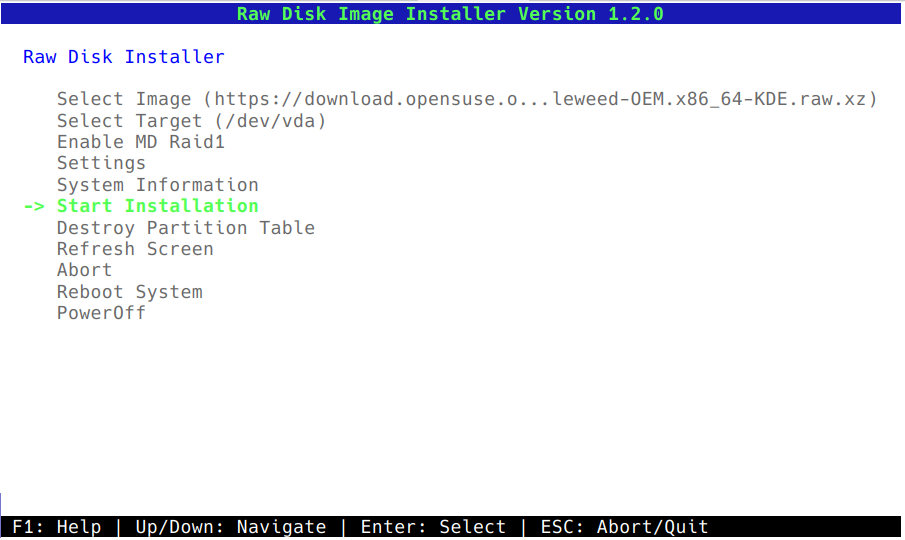
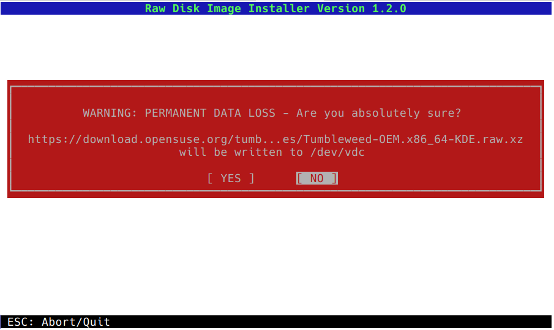
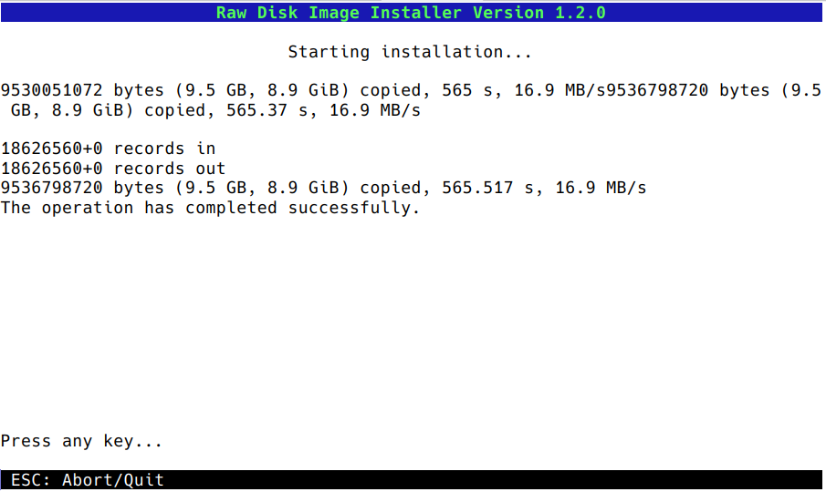
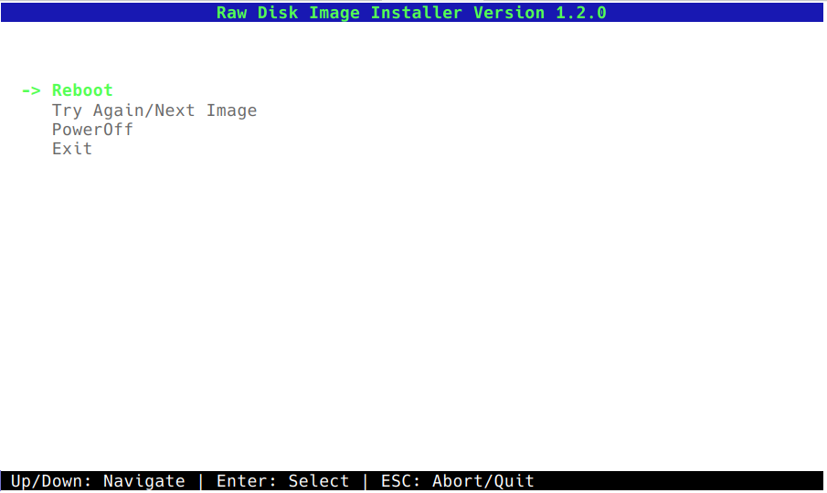

# Raw Disk Image Installer Quick Guide

The RDI-Installer offers a text UI for the correct settings.
In most cases, selecting an image and a target device before starting the installation is enough. But sometimes it is necessary to adjust at first some options.

In the settings dialog you can adjust:
* if the host ssh key should be backed up from an already installed system and copied back into the installed system.
* The URL from where images should be downloaded. In the "Select Image" dialog, this URL will be used to present existing images for installation. Under the URL a file SHA256SUMS is read to get the image names.
* The keyboard layout. This is only used for the installer itself to make it easier to type URLs and image names.

Now enter the `Select Image` dialog.

Three options to select an image are offered:
1. `Select image from download server` offers all images from the download URL in the settings dialog. To build a list of available images, `SHA256SUMS` and `SHA256SUMS.asc` are downloaded and verified with the openSUSE signing key.
2. With `Provide URL` a URL for an image can be entered.
3. `Use file selection` allows to browse for the image. Partitions with the label `images` will be auto-mounted below `/images`.

The dialog to select an image from a download server shows a list of all matching images. The dialog filters according to the extension of the image and the architecture of the system. There are three options:
* The default is `matching` and only images with the same architecture as the host are shown.
* `all` will show all images with a supported format.
* At last you can select per architecture, which allows to install e.g. an aarch64 image for a Raspberry Pi on an SD card on a x86-64 host.

After selecting an image for installation, a device needs to be selected, on which the image should be installed. The list contains the device name, the disk model if known, the interface, disk size and if the disk is the boot device, the default disk according to the firmware or if it is already mounted. Only disks with size of 10GB or greater are shown by default.

If an image and the target device got selected, RDI-Installer will automatically pre-select the "Start Installation" option.

Until now, no changes were made to the disk. If `YES` get selected, the destructive part starts and all data on the selected device gets overwritten.

You can follow the output of `dd` as it writes the image to disk.

